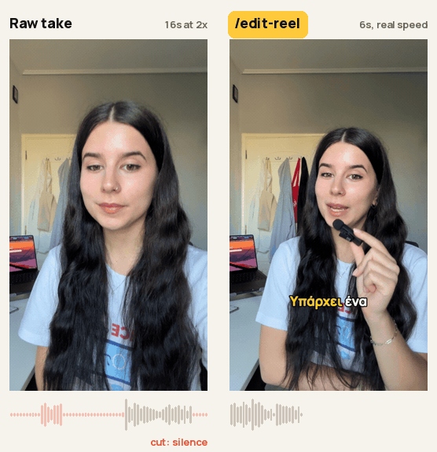

# edit-reel

I post to 27k followers and haven't edited a video by hand in 8 months. I film, Claude edits,
and my time goes to ideas and filming. These are the skills I use, made generic so they work for you.

<p align="center"></p>

Word-by-word karaoke subtitles in any language (English, Greek, Spanish, ...), silence and
retakes cut, subtle zooms, sound effects and image overlays. Plus the skills around the edit:
trimming messy raw footage, recording product demos, building a playback video to film, and
planning the shoot.

Formerly `edit-greek-reel`. It always worked in any language, so the name caught up.

## Install

### Claude Code (terminal, desktop app Code tab, IDE)

```
/plugin marketplace add artemisln/edit-reel
/plugin install edit-reel@artemis-codes
```

Then run `/edit-reel:edit-reel <video>` or just ask: "edit this reel: ~/Movies/raw.MOV".

### Claude app (claude.ai, desktop, mobile)

Customize › Plugins › Add › Add marketplace › `artemisln/edit-reel`, then turn on **edit-reel**.
The skills show up under Customize › Skills. Turn on "Code execution and file creation" in
settings. The chat sandbox may not have ffmpeg or Whisper available, so Claude Code on your own
machine is the reliable way to render.

### Manual

```bash
git clone https://github.com/artemisln/edit-reel.git
cp -r edit-reel/plugins/edit-reel/skills/* ~/.claude/skills/
```

Manual install gives you the short commands (`/edit-reel`, `/trim-raw-video`, ...).

## Requirements

- Python 3.10+ and ffmpeg (`brew install ffmpeg` on macOS, `choco install ffmpeg` on Windows)
- `pip install openai-whisper Pillow cairosvg`
- [Manrope](https://fonts.google.com/specimen/Manrope) font, Bold weight
- The Whisper medium model (~1.5 GB) downloads on first use

Skills with extra needs list them at the top of their own `SKILL.md` (for example Playwright for
`demo-reel-capture`).

## Skills

| Skill | What it does | Example |
|---|---|---|
| **edit-reel** | Raw talking head to finished 9:16 reel: transcribe, cut silence and retakes, karaoke subtitles, zooms, SFX, image overlays. | `/edit-reel ~/raw.MOV --lang en` |
| **trim-raw-video** | Very raw footage with retakes, crew chatter and false starts: keeps the clearest take of every line and splices one clean cut. | `/trim-raw-video ~/shoot/*.MOV` |
| **playback-capture** | Joins screen recordings into one continuous playback video, padded to fit your voiceover, so you can film your screen in a single take. | `/playback-capture ~/recordings/ script.md` |
| **demo-reel-capture** | Claude drives Chrome with Playwright and records a clean product demo (no extension overlay, no tabs, no Dock), then pairs it with your talking head. | `/demo-reel-capture https://example.com` |
| **sponsored-reel** | Edit style for sponsored reels: picture recut without touching the voiceover, pill captions, glowing hook title, measured SFX levels, optional bilingual subtitles. | `/sponsored-reel ~/cut.mp4` |
| **shot-list** | Turns an approved script or a reference video into a shot list you can film without making a single decision on set. | `/shot-list script.md` |

Installed as a plugin, each command is prefixed: `/edit-reel:trim-raw-video`, and so on.

### edit-reel options

```
/edit-reel ~/video.MOV --lang el              # language: en, el, es, fr, de, ... (asks if missing)
/edit-reel ~/video.MOV --crop-top 20          # crop 20% from the top
/edit-reel ~/video.MOV --no-images            # skip image overlays
/edit-reel ~/video.MOV --manual-text "..."    # use your own script instead of Whisper
```

### Sound effects

21 SFX ship with the skill: 6 from v1 (whoosh, cash, fah, click, bubble pop, riser) and 15
generated ones (pop, swish, thock, thud, sub drop, shimmer, rise, ding, success, fanfare, buzzer,
alert, undo, tick, swoop up). The skill picks them by meaning and never repeats one in a video.
To use your own, drop `.mp3` files into an `audios/` folder next to your video.

The generated sounds come from `plugins/edit-reel/skills/edit-reel/scripts/make-sfx.py`
(standard library plus ffmpeg) and are CC0. See [CREDITS.md](CREDITS.md).

### Image overlays

Put logos, screenshots or memes in an `images/` folder next to your video, named after what they
show (`cursor.png`, `github_copilot.png`). The skill overlays one when you mention it. If you keep
one asset library for all your videos, tell Claude its path.

## How edit-reel works

1. **Trim, crop, scale** (ffmpeg): cuts silence and retakes, crops to 9:16 without stretching, scales to 1080x1920.
2. **Subtitles, zooms, images** (Python and Pillow, frame by frame): word-by-word highlight in Manrope Bold, eased 1.08–1.10x zooms, pop-in overlays.
3. **SFX mix** (ffmpeg): sound effects on key words at 0.15–0.20 volume, under the voice.

Subtitle style: Manrope Bold 72px, white with a black outline, active word in gold, 2 words per
line, sentence case.

## Repo layout

```
.claude-plugin/marketplace.json      makes the repo installable from GitHub
plugins/edit-reel/
  .claude-plugin/plugin.json
  skills/
    edit-reel/          SKILL.md, audios/, scripts/make-sfx.py
    trim-raw-video/
    playback-capture/
    demo-reel-capture/
    sponsored-reel/
    shot-list/
```

## Tips

- Film in portrait (9:16).
- Speak naturally: retakes and pauses get cut.
- If Whisper mishears a word, the skill asks before rendering.
- Brand and tool names get proofread ("Cloud Code" becomes "Claude Code").

## Credits

Built by [Artemis Codes](https://instagram.com/artemis.codes) with Claude Code.
Thanks to [@Nonilas](https://github.com/Nonilas) for the language flag and SFX fixes in v1.
Sound sources in [CREDITS.md](CREDITS.md).

## License

MIT, see [LICENSE](LICENSE). Generated sounds are CC0.
